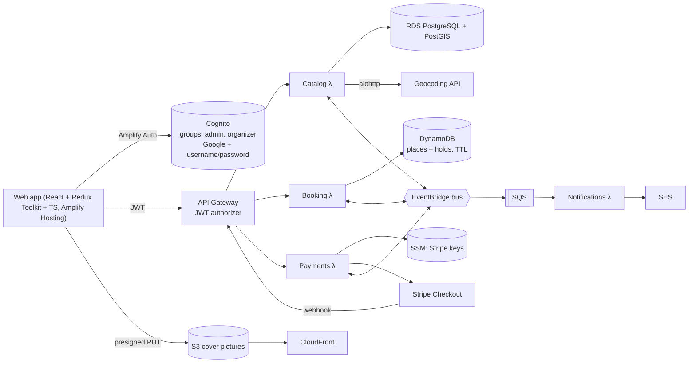

# Architecture

Localbini is an app for booking local events, built as a showcase of the stack in `spec.md`. Vocabulary follows `GLOSSARY.md`; key decisions are in `docs/adr/`.

## System overview



## Bounded contexts

| Service | Owns | Store | Publishes | Consumes |
|---|---|---|---|---|
| **Catalog** | Event, Location, Event status, Cover picture | PostgreSQL + PostGIS | `EventPublished`, `EventUpdated`, `EventCancelled` | — |
| **Booking** | Booking, Hold, Places counter | DynamoDB | `BookingRequested`, `BookingConfirmed`, `BookingCancelled`, `HoldExpired` | `EventPublished`, `EventUpdated`, `EventCancelled`, `PaymentSucceeded`, `PaymentFailed` |
| **Payments** | Checkout sessions | (Stripe + idempotency keys in DynamoDB) | `PaymentSucceeded`, `PaymentFailed` | `BookingRequested` |
| **Notifications** | Outgoing email | — | — | `BookingConfirmed`, `EventCancelled` (via SQS) |

Identity and roles live in Cognito. Admins assign the `organizer` group. Organizers manage only their own Events; Admins can manage any Event.

## Main flow: paid Booking

1. An Attendee asks for N places → Booking places a **Hold** with a conditional write (it fails if not enough places remain) → emits `BookingRequested`.
2. Payments creates a Stripe Checkout session → the web app redirects the Attendee to Stripe.
3. Stripe calls the webhook → Payments checks the signature → emits `PaymentSucceeded`.
4. Booking confirms the Booking → emits `BookingConfirmed` → Notifications emails the Attendee.
5. If payment never arrives, the DynamoDB TTL / scheduled sweep expires the Hold → places are released.

A free Event skips steps 2–3.

## Repository layout

```
infra/
  bootstrap/        # state bucket + GitHub OIDC role (applied once, by hand)
  modules/          # network, cognito, api, lambda-service, rds, dynamodb, eventbridge, ses, web
  envs/dev, envs/prod
services/
  shared/           # lbz helpers, auth/roles, event envelope, logging
  catalog/ booking/ payments/ notifications/
web/                # React + Vite + TS + Redux Toolkit
tests/
  e2e/              # Playwright
  smoke/            # aiohttp async smoke/load script
.github/workflows/
```

## Delivery & quality

- GitHub Actions: lint + unit tests on every PR; `terraform plan` on PR, `apply` to `dev` when merged to `main`; `prod` sits behind a manual approval step.
- Every ticket must ship with unit tests (pytest / Vitest), plus integration tests (against `dev`) and Playwright tests where they apply.
- An OWASP ZAP baseline scan runs against `dev` on a schedule as the automated pen test.

## Out of scope (for now)

OpenSearch, Flutter mobile app, Stripe Connect / Organizer payouts, refunds on cancellation, multiple currencies, SES production access.
